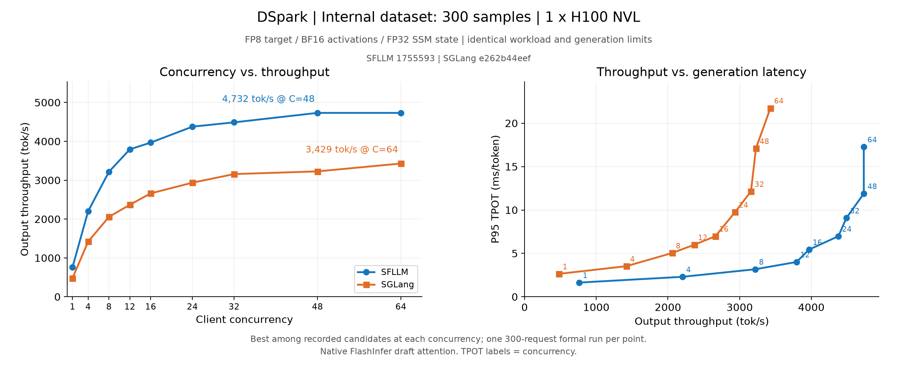

# DSpark on an internal dataset: SFLLM vs SGLang

The SGLang curve is corrected: native FlashInfer draft attention replaces the earlier forced-Triton draft backend. All nine corrected SGLang points are separate 300-request formal measurements; the nine previously validated SFLLM points are reused unchanged. Historical Triton measurements are retained under [history-triton](internal-dataset-dspark/history-triton/results.json).

## Source and workload

- SFLLM: [`17555935c3237ad1cf4afdd756943ae3f503dfa1`](https://github.com/wejoncy/sfllm/commit/17555935c3237ad1cf4afdd756943ae3f503dfa1), measured `qwen35_specfic` branch, ahead of the `main` documentation base.
- SGLang: official [`e262b44eef1f2bf83e34345276e2bb91a086587e`](https://github.com/sgl-project/sglang/commit/e262b44eef1f2bf83e34345276e2bb91a086587e). Clean checkout and equal per-file source hashes before/after every server lifetime. No SFLLM patches or migrated optimizations.
- One H100 NVL 96 GB. Target: user-provided `target`; draft: `dspark_ckpt6`, 6 layers consuming target layers [1,5,9,13,17,21,25,29]. Native `sample_from_anchor=false` model override.
- Same 300 prompts sampled without replacement from 500 internal dataset entries, seed42; SHA256 `8932bd9c7191221b3f953dea3a3addf441f352be9ca60c920710cfd65bec8876`. Each formal point: 300/300 successes, 1,351,215 input tokens, every per-request tokenized input length checked.
- BF16 activations, FP8 per-channel target, FP32 recurrent states, temperature0, max1000 output tokens, stop248044, context16384. Outputs are not required to be token-identical.
- Prefix caching enabled; flush after warmup and before each measurement. SFLLM warmup32/C32; SGLang warmup128/C64. SGLang native Mamba pool400 provides capacity80; decode graphs cover64. No simulator in tuning/formal generation.

Throughput = completed output tokens / full client wall time, including prefill and final drain; startup/warmup excluded. P95 TPOT is the request percentile of `(E2E - TTFT) / (output tokens - 1)`. Accept length excludes the first token: `(output tokens - requests) / verify calls`. Width4 acceptance near2.7 and width8 near3.3 are normal for this workload.

SFLLM returns input lengths as `final_meta_info.prompt_length`; SGLang uses `prompt_tokens`. The client summary only recognizes the latter and therefore reports zero input tokens for SFLLM. Verification reads the original per-request metadata and confirms identical input lengths and the 1,351,215-token sum in both engines. Output-throughput and latency calculations do not depend on that summary input counter.

## Configuration selection

Candidates are screened with `max(32, 2 * concurrency)` requests before selecting one separate formal300 run per concurrency. The corrected C12/C64 screening and formal points are reused from the alignment audit; other seven points were newly screened and measured. Small differences from single runs do not establish significance.

- SFLLM: fixed widths4/8 and SF prefix adaptive d8t4.5/d8t5/d8t6, selective draft FP8/top-k16, GDN journal.
- Corrected SGLang: native FlashInfer draft attention, widths4/6/8 BF16 draft plus width8 native draftFP8; FA3 target attention, FlashInfer GDN prefill/decode, native greedy drafting, overlap scheduling, prefix cache, CUDA graphs.
- These are independently selected practical configurations, with differing draft precision/search strategy. This curve is best among the recorded valid candidates, not proof of a global optimum or equal draft arithmetic.
- Native adaptive: the earlier cap-accept sweep used Triton draft attention and remains historical evidence. A FlashInfer-draft compact adaptive check with refitted B1/4/8/16/32/64 costs failed real warmup with a CUDA/CUBLAS error; it is excluded. Native GDN does not advertise compact ragged graph support at this SHA. Details and rejected configurations are in the [alignment audit](internal-dataset-dspark-alignment.md).

## Results

| Concurrency | SFLLM tok/s | SGLang tok/s | SFLLM / SGLang |
| ---: | ---: | ---: | ---: |
| 1 | 760.59 | 479.54 | 1.586x |
| 4 | 2202.29 | 1420.17 | 1.551x |
| 8 | 3218.14 | 2057.68 | 1.564x |
| 12 | 3794.36 | 2367.83 | 1.602x |
| 16 | 3967.85 | 2661.87 | 1.491x |
| 24 | 4377.75 | 2935.62 | 1.491x |
| 32 | 4488.79 | 3157.83 | 1.421x |
| 48 | 4732.20 | 3227.25 | 1.466x |
| 64 | 4731.39 | 3429.20 | 1.380x |

Observed peaks within concurrency1–64:

- SFLLM: 4732.20 tok/s at C48 (`fixed4`).
- SGLang: 3429.20 tok/s at C64 (`draft-flashinfer-w4`).

| Framework | Concurrency | Configuration | Output tok/s | P95 TPOT ms | P95 TTFT ms | Accept length | Success |
| --- | ---: | --- | ---: | ---: | ---: | ---: | ---: |
| sfllm | 1 | fixed8 | 760.59 | 1.64 | 116.86 | 3.335 | 300/300 |
| sfllm | 4 | fixed8 | 2202.29 | 2.30 | 149.44 | 3.321 | 300/300 |
| sfllm | 8 | d8t6 | 3218.14 | 3.17 | 182.25 | 3.303 | 300/300 |
| sfllm | 12 | d8t5 | 3794.36 | 4.01 | 210.19 | 3.212 | 300/300 |
| sfllm | 16 | d8t6 | 3967.85 | 5.44 | 225.50 | 3.307 | 300/300 |
| sfllm | 24 | d8t5 | 4377.75 | 6.98 | 557.97 | 3.219 | 300/300 |
| sfllm | 32 | d8t5 | 4488.79 | 9.08 | 906.70 | 3.216 | 300/300 |
| sfllm | 48 | fixed4 | 4732.20 | 11.89 | 1888.84 | 2.690 | 300/300 |
| sfllm | 64 | d8t4.5 | 4731.39 | 17.27 | 2719.59 | 3.131 | 300/300 |
| sglang | 1 | draft-flashinfer-fp8 | 479.54 | 2.65 | 139.10 | 3.319 | 300/300 |
| sglang | 4 | draft-flashinfer | 1420.17 | 3.53 | 188.46 | 3.335 | 300/300 |
| sglang | 8 | draft-flashinfer | 2057.68 | 5.04 | 207.47 | 3.320 | 300/300 |
| sglang | 12 | draft-flashinfer-w4 | 2367.83 | 6.00 | 242.22 | 2.685 | 300/300 |
| sglang | 16 | draft-flashinfer-w4 | 2661.87 | 6.98 | 281.73 | 2.688 | 300/300 |
| sglang | 24 | draft-flashinfer-w4 | 2935.62 | 9.75 | 708.04 | 2.694 | 300/300 |
| sglang | 32 | draft-flashinfer-w4 | 3157.83 | 12.14 | 1121.21 | 2.683 | 300/300 |
| sglang | 48 | draft-flashinfer-w4 | 3227.25 | 17.08 | 2312.89 | 2.687 | 300/300 |
| sglang | 64 | draft-flashinfer-w4 | 3429.20 | 21.75 | 3215.06 | 2.693 | 300/300 |

## Runtime and reproducibility

| Framework | Torch | Triton | FlashInfer | Transformers |
| --- | --- | --- | --- | --- |
| SFLLM | 2.13.0+cu130 | 3.7.1 | 0.6.18 | 5.12.1 |
| SGLang | 2.14.1+cu130 | 3.8.0 | 0.7.2 | 5.19.0 |

See [results CSV](internal-dataset-dspark/results.csv), [commands](internal-dataset-dspark/commands.json), [selection scores](internal-dataset-dspark/sglang-selection.json), [verification](internal-dataset-dspark/verification.json), and [protocol](internal-dataset-dspark/protocol.json). Runtime/import/dependency-integrity metadata remain adjacent. Dataset names and dataset-identifying paths use `internal-dataset` placeholders; substitute local paths when running the published commands. Measurements and hashes are unchanged. Full server logs, original request records, and source manifests remain in the private experiment directory. Private checkpoint files and prompt text are not bundled. Re-render using `python docs/benchmarks/internal-dataset-dspark/plot.py --output /tmp/comparison.png`.
