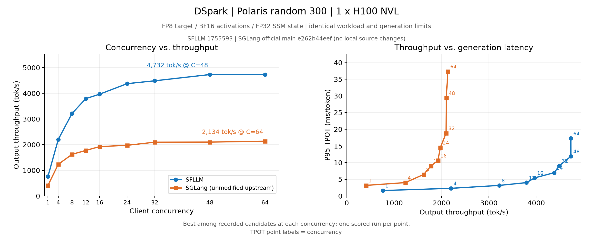

# DSpark on Polaris: SFLLM vs unmodified upstream SGLang

## Scope and source revisions

- SFLLM: [`17555935c3237ad1cf4afdd756943ae3f503dfa1`](https://github.com/wejoncy/sfllm/commit/17555935c3237ad1cf4afdd756943ae3f503dfa1), the measured `qwen35_specfic` branch, two commits ahead of the `main` base of this documentation PR.
- SGLang: official [`e262b44eef1f2bf83e34345276e2bb91a086587e`](https://github.com/sgl-project/sglang/commit/e262b44eef1f2bf83e34345276e2bb91a086587e). The independent checkout is clean before and after each server lifetime. No local engine patches, SF prefix policy, selective draft FP8, or migrated kernels are used.
- SGLang source and imports are audited; packaged Torch, FlashInfer, SGLang kernels, Triton, Transformers, compressed-tensors, and Tokenizers files match their installed distribution RECORD hashes.

Matching fixed width 8 screening on the same 128 requests gives mean acceptance 3.297 (SFLLM) and 3.334 (SGLang), excluding the initial token. See [acceptance alignment](polaris-dspark/acceptance-alignment.json).

## Workload and measurement

One H100 NVL 96 GB. The target is the user-provided `target` checkpoint; draft is `dspark_ckpt6`. Both frameworks use the same 300 prompts sampled without replacement from the 500-entry Polaris dataset, seed 42. BF16 runtime activations, FP8 target weights, FP32 recurrent states, temperature 0, max 1000 output tokens, stop token 248044, context 16384. All tokenized input lengths match. Mean input length is 4504.05 tokens (range 2272–13475).

Prefix caching is enabled and flushed after warmup and before each measurement. SFLLM warmup uses 32 requests at concurrency 32; SGLang warmup uses 128 at concurrency 64 to warm process-local FlashInfer CuTE compilations. Client concurrencies are 1, 4, 8, 12, 16, 24, 32, 48, 64. SFLLM server capacity is 64. SGLang uses native Mamba pool sizing to provide capacity 80 for widths 6/8/adaptive; width 16 uses capacity 64, the native no_buffer prefix-cache strategy, static memory fraction 0.93, prefill chunk size 4096, and disables the optional free-slot admission delay. The initial default-pool width 8 candidate is eligible only through concurrency 48, where its capacity 57 covers the client load; an 80-slot width 8 candidate is additionally screened at concurrencies 48 and 64. All selected formal server capacities cover the corresponding client concurrency. Decode graph capacity is 64.

Throughput = completed output tokens / full client benchmark wall time, including prefill and final drain. Startup and warmup are excluded. P95 TPOT is the request percentile of `(end-to-end time - TTFT) / (output tokens - 1)`, not the percentile of individual token gaps. Each formal point runs once; small differences do not establish statistical significance. Outputs need not be token-identical; output lengths and acceptance are recorded. The acceptance column is `(output tokens - request count) / verify calls`, excluding the first token of each request.

## Runtime versions

| Framework | Torch | Triton | FlashInfer | Transformers |
| --- | --- | --- | --- | --- |
| SFLLM | 2.13.0+cu130 | 3.7.1 | 0.6.18 | 5.12.1 |
| SGLang | 2.14.1+cu130 | 3.8.0 | 0.7.2 | 5.19.0 |

The [runtime metadata](polaris-dspark/runtime-versions.json) and [hardware metadata](polaris-dspark/hardware.json) record the serving environments. Target GEMMs use FP8 per-channel weights and dynamic per-token input quantization.

## Configuration search

Each configuration is screened with `max(32, 2 * concurrency)` prompts from the same sample. The highest valid tuning throughput selects the configuration for a separate formal 300-prompt run. Selection is limited to the recorded candidates.

- SFLLM: fixed widths 4 and 8, plus SF prefix adaptive `d8t4.5`, `d8t5`, `d8t6`; draft top-k 16, draft FP8, GDN journal enabled.
- Official SGLang: fixed widths 2, 4, 6, 8, 16 and the native confidence/SPS adaptive policy. A native no_buffer prefix-cache candidate at width 8 is also screened at every concurrency. Upstream requires overlap scheduling to be disabled for no_buffer; other candidates keep overlap enabled. Native greedy drafting is enabled. Target attention uses FA3; draft attention uses the native Triton backend, which accounts for this legacy checkpoint’s anchor query. The draft has 6 layers and consumes target layers [1,5,9,13,17,21,25,29]; `sample_from_anchor=false` is set via the supported model override.
- Native cost fitting reuses the successful B1/4/8/16/32 measurements and supplements B64 after correcting the native Mamba pool capacity. The fitted table covers B64.
- Native adaptive is evaluated in `cap-accept` mode with a cost table measured on this unmodified engine. The tested upstream GDN backend does not advertise compact ragged graph support; no support code is added for this benchmark. Acceptance simulation is restricted to the native SPS profiler’s compute-cost fitting and is absent from every tuning/formal workload.
- Each framework uses its working dependency environment; see `polaris-dspark/runtime-versions.json`.

## Native adaptive screening

This table reports screening workloads; the plotted formal curves use 300 requests per point. Caps come from upstream per-request histograms and include the anchor token. In cap-accept mode, the physical target verification still computes all 8 positions; the scheduled cap limits the accepted prefix. Acceptance here follows upstream metadata: completion tokens / verify calls.

| Concurrency | Screening requests | Native adaptive tok/s | Accept length | Mean scheduled cap |
| ---: | ---: | ---: | ---: | ---: |
| 1 | 32 | 382.08 | 3.439 | 7.947 |
| 4 | 32 | 1145.02 | 3.441 | 7.841 |
| 8 | 32 | 1492.53 | 3.431 | 7.782 |
| 12 | 32 | 1651.43 | 3.442 | 7.318 |
| 16 | 32 | 1796.29 | 3.450 | 7.288 |
| 24 | 48 | 1974.08 | 3.472 | 7.928 |
| 32 | 64 | 2112.80 | 3.464 | 6.721 |
| 48 | 96 | 2085.42 | 3.380 | 6.572 |
| 64 | 128 | 2122.38 | 3.337 | 6.657 |

## Results

| Concurrency | SFLLM tok/s | Official SGLang tok/s | SFLLM / SGLang |
| ---: | ---: | ---: | ---: |
| 1 | 760.59 | 407.89 | 1.865x |
| 4 | 2202.29 | 1234.86 | 1.783x |
| 8 | 3218.14 | 1622.13 | 1.984x |
| 12 | 3794.36 | 1776.65 | 2.136x |
| 16 | 3967.85 | 1924.21 | 2.062x |
| 24 | 4377.75 | 1975.67 | 2.216x |
| 32 | 4488.79 | 2096.43 | 2.141x |
| 48 | 4732.20 | 2101.05 | 2.252x |
| 64 | 4731.39 | 2134.11 | 2.217x |

Observed peaks within concurrency 1–64:

- SFLLM: 4732.20 tok/s at concurrency 48 (`fixed4`).
- SGLang (unmodified upstream): 2134.11 tok/s at concurrency 64 (`fixed6`).

| Framework | Concurrency | Configuration | Output tok/s | P95 TPOT ms | P95 TTFT ms | Accept length | Success |
| --- | ---: | --- | ---: | ---: | ---: | ---: | ---: |
| sfllm | 1 | fixed8 | 760.59 | 1.64 | 116.86 | 3.335 | 300/300 |
| sfllm | 4 | fixed8 | 2202.29 | 2.30 | 149.44 | 3.321 | 300/300 |
| sfllm | 8 | d8t6 | 3218.14 | 3.17 | 182.25 | 3.303 | 300/300 |
| sfllm | 12 | d8t5 | 3794.36 | 4.01 | 210.19 | 3.212 | 300/300 |
| sfllm | 16 | d8t6 | 3967.85 | 5.44 | 225.50 | 3.307 | 300/300 |
| sfllm | 24 | d8t5 | 4377.75 | 6.98 | 557.97 | 3.219 | 300/300 |
| sfllm | 32 | d8t5 | 4488.79 | 9.08 | 906.70 | 3.216 | 300/300 |
| sfllm | 48 | fixed4 | 4732.20 | 11.89 | 1888.84 | 2.690 | 300/300 |
| sfllm | 64 | d8t4.5 | 4731.39 | 17.27 | 2719.59 | 3.131 | 300/300 |
| sglang | 1 | fixed8 | 407.89 | 3.19 | 135.23 | 3.327 | 300/300 |
| sglang | 4 | fixed8 | 1234.86 | 4.02 | 184.52 | 3.323 | 300/300 |
| sglang | 8 | fixed8 | 1622.13 | 6.44 | 193.89 | 3.332 | 300/300 |
| sglang | 12 | fixed8 | 1776.65 | 8.99 | 231.36 | 3.318 | 300/300 |
| sglang | 16 | fixed6 | 1924.21 | 10.64 | 330.93 | 3.101 | 300/300 |
| sglang | 24 | fixed4 | 1975.67 | 14.53 | 705.15 | 2.690 | 300/300 |
| sglang | 32 | fixed6 | 2096.43 | 18.83 | 1117.08 | 3.118 | 300/300 |
| sglang | 48 | fixed8-cap80 | 2101.05 | 29.37 | 2251.25 | 3.334 | 300/300 |
| sglang | 64 | fixed6 | 2134.11 | 37.37 | 3212.49 | 3.111 | 300/300 |

## Reproducibility

The [CSV results](polaris-dspark/results.csv), [exact commands](polaris-dspark/commands.json), [native adaptive observations](polaris-dspark/native-adaptive-observations.json), and [verification](polaris-dspark/verification.json) are available in the adjacent `polaris-dspark/` directory. It also contains the workload protocol and sample indices/hash, runtime versions, upstream integrity checks, candidate selection scores, native SPS costs, and exact selected server/client commands. The local experiment additionally retains complete server logs, per-request records, and full source hash manifests. The private checkpoints and prompt text are not bundled.
